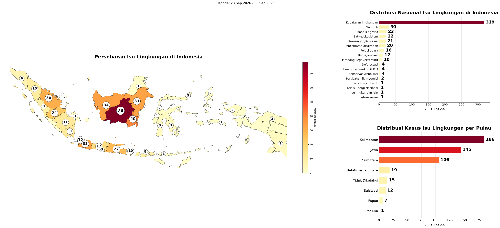
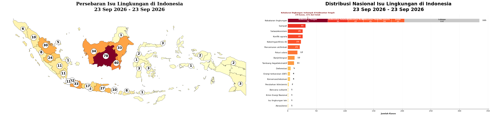

# Environmental Issue Monitoring

Turn a raw export of Indonesian news and social-media mentions into a one-page picture of **which environmental issues are discussed, and where**: issue categories, province and island, a choropleth map, and the top issues with source links.

[](https://colab.research.google.com/github/aldo02032004/environmental-issue-monitoring/blob/main/environmental_issue_monitoring.ipynb)



## Results on a real dataset

One day of monitoring data (23 Sep 2026), published with permission:

| Step | Result |
|---|---|
| Raw mentions loaded | 1,826 |
| After cleaning and de-duplicating syndicated copies | 532 unique documents |
| Issue categories found | 17 (plus a *noise* bucket for off-topic posts) |
| Processing time (classification + location) | under 3 seconds |

What the run shows:

- **Forest and land fires dominate** (*Kebakaran lingkungan*, about two-thirds of all mapped issues). Kalimantan Tengah is the largest single contributor (70 cases, 21%).
- **Kalimantan leads by island** (186 cases), followed by Jawa (145) and Sumatera (106).
- Waste, agrarian conflict, wildlife/ecosystem and drought each account for 20–30 cases.



## How it works

1. **Ingest**: read an Excel export from a Google Sheets / Drive link or a local `.xlsx`. The best-matching sheet is chosen automatically, and the download retries on transient errors.
2. **Clean**: remove news boilerplate, URLs, hashtags and mentions, then drop syndicated duplicates (same headline and opening text).
3. **Classify issues**: rule-based classification into environmental issue categories after slang normalisation, with a geo-gate that marks foreign news as noise.
4. **Locate**: detect province and island from free text with a gazetteer-based resolver. Mentions that name only an island are spread proportionally over its provinces.
5. **Visualise**: a choropleth map of Indonesia, national and per-island bar charts, the top issue broken down by province, and tables of the top issues per island (news) and on social media, with source links.

The two dashboards count slightly differently. The first leaves out nationwide news that cannot be placed on the map, while the second keeps it. The notebook explains this next to each chart.

## Quick start (Google Colab)

1. Open the notebook with the badge above.
2. In step **2. Load data**, set `SOURCE` to your Google Sheets / Drive link (shared as *Anyone with the link*) or an `.xlsx` path.
3. `Runtime → Run all`.

No API key or token is needed. Running outside Colab: `pip install -r requirements.txt`, then open the notebook in Jupyter.

## Input format

An Excel export with one title row, then a header row containing at least `No`, `Headline`, `Mentions`, `Date`, `Link`, `Sentiment`, `Author`.

## Tech stack

Python · pandas · GeoPandas · Matplotlib · [GREAT-Tools](https://github.com/azmkto/GREAT-Tools) (issue rules, location resolver, slang normalisation) · Google Colab

## Project structure

```
environmental-issue-monitoring/
├── environmental_issue_monitoring.ipynb   # full pipeline with saved outputs
├── docs/                                  # dashboard images used in this README
├── requirements.txt
└── LICENSE
```

## Limitations

- Issue classification is rule-based: fast and transparent, but new phrasing needs new rules.
- Location comes from the text, not from where the author is, so national news without a place name cannot be mapped.
- The example covers a single day; trends need a longer export.

## License

MIT, see [LICENSE](LICENSE).
